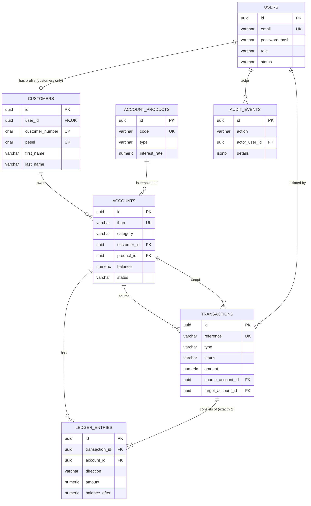
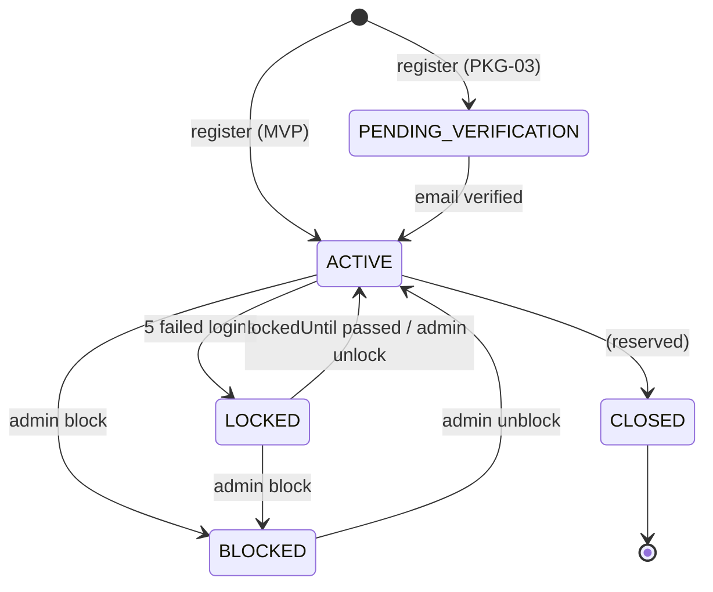
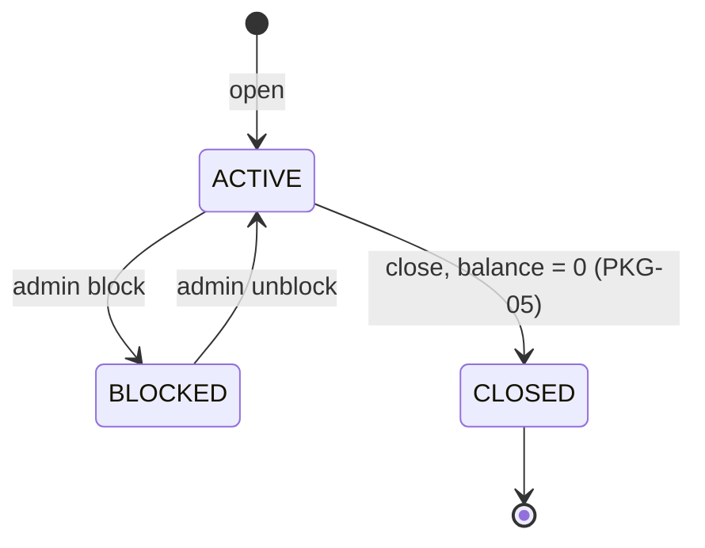
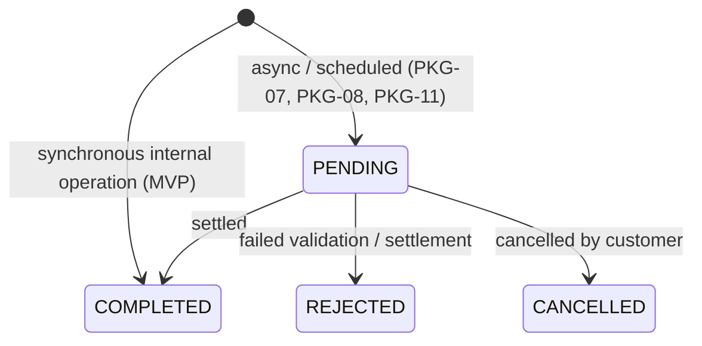

# 03 — Domain Model & Data Dictionary

This is the **single source of truth for data**: every entity, field, type, constraint, enum value and default. Backend entities, SQL migrations and frontend models must match this document.

> Changing this document requires approval from both the backend and the frontend developer.

---

## 1. Modelling principles

| # | Principle | Consequence |
|---|---|---|
| P1 | **Double-entry ledger** ([ADR-0005](adr/0005-double-entry-ledger.md)) | Money never appears or disappears. Every transaction moves an amount from one account to another; cash, interest and tax go through **system accounts**. |
| P2 | **Transactions are immutable** | Transactions and ledger entries are only inserted, never updated or deleted (status changes are allowed only for future async flows: `PENDING → COMPLETED/REJECTED`). Corrections are new transactions. |
| P3 | **Accounts are instances of products** ([ADR-0006](adr/0006-account-product-catalog.md)) | Rules (interest, policy, max count) live in `account_products`, not in code branches. A new product = a new row. |
| P4 | **Separate login from banking identity** | `User` (credentials, role) ≠ `Customer` (personal data). Admin = user without customer. |
| P5 | **Money is exact** ([ADR-0004](adr/0004-money-representation.md)) | `BigDecimal` / `NUMERIC(19,2)` / JSON string. Never `double`/`float`/JS `number` arithmetic. |
| P6 | **UUID identifiers** ([ADR-0003](adr/0003-uuid-identifiers.md)) | All primary keys are UUID; public numbers (IBAN, customer number, reference) are separate business keys. |
| P7 | **Enums stored as strings** | `VARCHAR` + `CHECK` constraint, Java `@Enumerated(EnumType.STRING)`. New values can be added with a migration without renumbering. |
| P8 | **Additive evolution** | New fields are added as nullable or with defaults; existing fields are not renamed or repurposed. Values marked *Reserved* are defined now but unused in the MVP. |
| P9 | **Nothing is physically deleted** | Users, customers, accounts are closed via status. Audit trail stays complete. |

---

## 2. Entity-relationship diagram



---

## 3. Conventions

### 3.1 Naming

| Context | Convention | Example |
|---|---|---|
| SQL tables | `snake_case`, plural | `ledger_entries` |
| SQL columns | `snake_case` | `customer_number` |
| Java classes / fields | `PascalCase` / `camelCase` | `LedgerEntry.balanceAfter` |
| JSON / TypeScript | `camelCase` | `balanceAfter` |
| Enum values | `UPPER_SNAKE_CASE` everywhere | `INTERNAL_TRANSFER` |

### 3.2 Type mapping

| Concept | Java | PostgreSQL | JSON / TypeScript |
|---|---|---|---|
| Identifier | `UUID` | `UUID` | `string` (UUID) |
| Money | `BigDecimal` (scale 2) | `NUMERIC(19,2)` | `string` e.g. `"1250.00"` |
| High-precision money (accruals) | `BigDecimal` (scale 6) | `NUMERIC(19,6)` | `string` |
| Interest rate (% p.a.) | `BigDecimal` (scale 4) | `NUMERIC(7,4)` | `string` e.g. `"4.0000"` |
| Currency | `String` (ISO 4217) | `CHAR(3)` | `string` e.g. `"PLN"` |
| Timestamp | `Instant` | `TIMESTAMPTZ` | `string` ISO-8601 UTC `"2026-10-24T13:02:11Z"` |
| Date | `LocalDate` | `DATE` | `string` `"2026-10-24"` |
| Enum | Java `enum` | `VARCHAR(n)` + `CHECK` | string literal union |
| Free JSON | `Map<String,Object>` / `JsonNode` | `JSONB` | `Record<string, unknown>` |

### 3.3 Common columns

Every mutable entity (users, customers, account_products, accounts) has:

| Field | Column | Java | SQL | Notes |
|---|---|---|---|---|
| `id` | `id` | `UUID` | `UUID PRIMARY KEY` | Generated by the application (`UUID.randomUUID()`), so the ID is known before insert. |
| `createdAt` | `created_at` | `Instant` | `TIMESTAMPTZ NOT NULL` | Set on insert (JPA auditing). |
| `updatedAt` | `updated_at` | `Instant` | `TIMESTAMPTZ NOT NULL` | Set on every update. |
| `version` | `version` | `long` | `BIGINT NOT NULL DEFAULT 0` | JPA `@Version` — optimistic locking. |

Immutable entities (transactions, ledger_entries, audit_events) have `id` and `created_at` only.

---

## 4. Enumerations

| Enum | Values | Used in |
|---|---|---|
| `Role` | `CUSTOMER`, `ADMIN` | User.role |
| `UserStatus` | `PENDING_VERIFICATION` *(Reserved, PKG-03)*, `ACTIVE`, `LOCKED`, `BLOCKED`, `CLOSED` *(Reserved)* | User.status |
| `AccountType` | `PERSONAL`, `SAVINGS` | AccountProduct.type, Account DTO |
| `AccountCategory` | `CUSTOMER`, `SYSTEM` | Account.category |
| `AccountStatus` | `ACTIVE`, `BLOCKED`, `CLOSED` *(Reserved, PKG-05)* | Account.status |
| `OutgoingTransferPolicy` | `ANY`, `OWN_ACCOUNTS_ONLY` | AccountProduct.outgoingTransferPolicy |
| `SystemAccountCode` | `BANK_CASH`, `BANK_INTEREST_EXPENSE`, `BANK_TAX_LIABILITY`, `BANK_FEE_INCOME` *(Reserved, PKG-06)* | Account.systemCode |
| `TransactionType` | MVP: `OWN_TRANSFER`, `INTERNAL_TRANSFER`, `CASH_DEPOSIT`, `CASH_WITHDRAWAL`, `INTEREST`, `TAX`. Reserved: `FEE` (PKG-06), `EXTERNAL_TRANSFER_OUT`, `EXTERNAL_TRANSFER_IN` (PKG-08), `PHONE_TRANSFER` (PKG-10), `BLIK_PAYMENT`, `BLIK_WITHDRAWAL` (PKG-11), `CARD_PAYMENT` (PKG-12), `FX_EXCHANGE` (PKG-13) | Transaction.type |
| `TransactionStatus` | `COMPLETED`; Reserved: `PENDING`, `REJECTED`, `CANCELLED` (PKG-07/08/11) | Transaction.status |
| `Channel` | `WEB`, `ATM`, `BRANCH`, `SYSTEM`; Reserved: `MOBILE`, `API` | Transaction.channel |
| `EntryDirection` | `DEBIT` (money out), `CREDIT` (money in) | LedgerEntry.direction |
| `AuditAction` | see [§5.8](#58-auditevent) | AuditEvent.action |

**Rule:** the frontend must handle unknown enum values gracefully (show the raw value), because new values may be added by the backend.

---

## 5. Entities

Column legend: **Null** = nullable; **API** = exposed in API DTOs (✓) or internal only (—); **Since** = MVP or package that introduces it.

### 5.1 User

Table `users`. Login identity of anybody who can sign in.

| Field | Column | Java | SQL | Null | Constraints / validation | API | Since |
|---|---|---|---|---|---|---|---|
| id | id | UUID | UUID | no | PK | ✓ | MVP |
| email | email | String | VARCHAR(254) | no | Unique; lower-cased; RFC email format (BR-01) | ✓ | MVP |
| passwordHash | password_hash | String | VARCHAR(100) | no | BCrypt hash (NFR-SEC-01) | — | MVP |
| role | role | Role | VARCHAR(20) | no | CHECK in enum | ✓ | MVP |
| status | status | UserStatus | VARCHAR(30) | no | CHECK in enum; default `ACTIVE` | ✓ | MVP |
| statusReason | status_reason | String | VARCHAR(255) | yes | Reason of last block/unblock (admin) | ✓ admin | MVP |
| failedLoginAttempts | failed_login_attempts | int | INTEGER | no | Default 0; reset on success | ✓ admin | MVP |
| lockedUntil | locked_until | Instant | TIMESTAMPTZ | yes | Set when locked (BR-23) | ✓ | MVP |
| lastLoginAt | last_login_at | Instant | TIMESTAMPTZ | yes | | ✓ | MVP |
| emailVerifiedAt | email_verified_at | Instant | TIMESTAMPTZ | yes | Always null in MVP | — | PKG-03 |
| createdAt, updatedAt, version | | | | | §3.3 | createdAt ✓ | MVP |

### 5.2 Customer

Table `customers`. Banking identity — personal data of a client.

| Field | Column | Java | SQL | Null | Constraints / validation | API | Since |
|---|---|---|---|---|---|---|---|
| id | id | UUID | UUID | no | PK | ✓ | MVP |
| user | user_id | User (`@OneToOne`) | UUID | no | FK → users.id, unique | ✓ (userId) | MVP |
| customerNumber | customer_number | String | CHAR(8) | no | Unique; generated (§8.2) | ✓ | MVP |
| firstName | first_name | String | VARCHAR(100) | no | 1–100, letters, spaces, `-`, `'` | ✓ | MVP |
| lastName | last_name | String | VARCHAR(100) | no | 1–100, letters, spaces, `-`, `'` | ✓ | MVP |
| pesel | pesel | String | CHAR(11) | no | Unique; checksum (BR-03); masked in customer API (NFR-SEC-06) | ✓ masked | MVP |
| dateOfBirth | date_of_birth | LocalDate | DATE | no | Derived from PESEL; age ≥ 18 (BR-04) | ✓ | MVP |
| phoneNumber | phone_number | String | VARCHAR(16) | no | E.164, e.g. `+48501234567`; not unique in MVP | ✓ | MVP |
| residentialAddress | address_* | Address (`@Embedded`) | see §5.3 | no | | ✓ | MVP |
| createdAt, updatedAt, version | | | | | §3.3 | | MVP |

### 5.3 Address (embeddable)

Embedded in `customers` with column prefix `address_`. A correspondence address in the future = second embedded set with prefix `corr_address_` (additive).

| Field | Column | Java | SQL | Null | Validation |
|---|---|---|---|---|---|
| street | address_street | String | VARCHAR(100) | no | 1–100 |
| buildingNumber | address_building_number | String | VARCHAR(10) | no | 1–10, e.g. `12A` |
| apartmentNumber | address_apartment_number | String | VARCHAR(10) | yes | 1–10 |
| postalCode | address_postal_code | String | VARCHAR(10) | no | `^\d{2}-\d{3}$` when country = PL |
| city | address_city | String | VARCHAR(100) | no | 1–100 |
| countryCode | address_country_code | String | CHAR(2) | no | ISO 3166-1 alpha-2; default `PL` (backend) |

### 5.4 AccountProduct

Table `account_products`. Catalog of account types; seeded by migration (§9.1).

| Field | Column | Java | SQL | Null | Constraints / notes | API | Since |
|---|---|---|---|---|---|---|---|
| id | id | UUID | UUID | no | PK | ✓ | MVP |
| code | code | String | VARCHAR(50) | no | Unique, stable business key, e.g. `SAVINGS_STANDARD` | ✓ | MVP |
| name | name | String | VARCHAR(100) | no | Display name | ✓ | MVP |
| description | description | String | VARCHAR(500) | yes | Shown in catalog | ✓ | MVP |
| type | type | AccountType | VARCHAR(20) | no | | ✓ | MVP |
| currency | currency | String | CHAR(3) | no | `PLN` | ✓ | MVP |
| interestRate | interest_rate | BigDecimal | NUMERIC(7,4) | no | % per annum, ≥ 0 | ✓ | MVP |
| outgoingTransferPolicy | outgoing_transfer_policy | OutgoingTransferPolicy | VARCHAR(30) | no | BR-14 | ✓ | MVP |
| atmAllowed | atm_allowed | boolean | BOOLEAN | no | BR-20 | ✓ | MVP |
| maxAccountsPerCustomer | max_accounts_per_customer | int | INTEGER | no | > 0 (BR-07) | ✓ | MVP |
| prerequisiteType | prerequisite_type | AccountType | VARCHAR(20) | yes | BR-08 | ✓ | MVP |
| active | active | boolean | BOOLEAN | no | Inactive products cannot be opened | — | MVP |
| defaultDailyTransferLimit | default_daily_transfer_limit | BigDecimal | NUMERIC(19,2) | yes | | ✓ | PKG-01 |
| maxDailyTransferLimit | max_daily_transfer_limit | BigDecimal | NUMERIC(19,2) | yes | | ✓ | PKG-01 |
| monthlyFee | monthly_fee | BigDecimal | NUMERIC(19,2) | yes | | ✓ | PKG-06 |
| createdAt, updatedAt, version | | | | | §3.3 | | MVP |

### 5.5 Account

Table `accounts`. Both customer accounts and system accounts.

| Field | Column | Java | SQL | Null | Constraints / notes | API | Since |
|---|---|---|---|---|---|---|---|
| id | id | UUID | UUID | no | PK | ✓ | MVP |
| iban | iban | String | VARCHAR(34) | no | Unique; stored without spaces, e.g. `PL45999000121000000000000001` (§8.1) | ✓ | MVP |
| category | category | AccountCategory | VARCHAR(20) | no | | — | MVP |
| customer | customer_id | Customer | UUID | yes | FK; **required** when category = CUSTOMER, null for SYSTEM | ✓ (customerId, admin) | MVP |
| product | product_id | AccountProduct | UUID | yes | FK; required when CUSTOMER | ✓ (as product summary) | MVP |
| systemCode | system_code | SystemAccountCode | VARCHAR(50) | yes | Unique; required when SYSTEM | ✓ admin | MVP |
| name | name | String | VARCHAR(50) | no | BR-28; default = product name / system code | ✓ | MVP |
| currency | currency | String | CHAR(3) | no | Copied from product | ✓ | MVP |
| balance | balance | BigDecimal | NUMERIC(19,2) | no | Default 0; `CHECK (category = 'SYSTEM' OR balance >= 0)` (BR-11) | ✓ | MVP |
| accruedInterest | accrued_interest | BigDecimal | NUMERIC(19,6) | no | Default 0; interest accrued since last capitalization | ✓ (savings) | MVP |
| lastAccrualDate | last_accrual_date | LocalDate | DATE | yes | Last day for which interest was accrued (idempotency) | — | MVP |
| status | status | AccountStatus | VARCHAR(20) | no | Default `ACTIVE` | ✓ | MVP |
| statusReason | status_reason | String | VARCHAR(255) | yes | Reason of block | ✓ admin | MVP |
| openedAt | opened_at | Instant | TIMESTAMPTZ | no | | ✓ | MVP |
| closedAt | closed_at | Instant | TIMESTAMPTZ | yes | | ✓ | PKG-05 |
| dailyTransferLimit | daily_transfer_limit | BigDecimal | NUMERIC(19,2) | yes | Customer-chosen, ≤ product max | ✓ | PKG-01 |
| createdAt, updatedAt, version | | | | | §3.3 | | MVP |

Table-level constraints:

```sql
CHECK ( (category = 'CUSTOMER' AND customer_id IS NOT NULL AND product_id IS NOT NULL AND system_code IS NULL)
     OR (category = 'SYSTEM'   AND customer_id IS NULL     AND product_id IS NULL     AND system_code IS NOT NULL) )
```

Indexes: `customer_id`, `status`.

### 5.6 Transaction

Table `transactions`. One business operation. **Immutable** (P2).

| Field | Column | Java | SQL | Null | Constraints / notes | API | Since |
|---|---|---|---|---|---|---|---|
| id | id | UUID | UUID | no | PK | ✓ | MVP |
| reference | reference | String | VARCHAR(24) | no | Unique, human-readable (§8.3) | ✓ | MVP |
| type | type | TransactionType | VARCHAR(30) | no | Determined by backend (BR-15) | ✓ | MVP |
| status | status | TransactionStatus | VARCHAR(20) | no | MVP always `COMPLETED` | ✓ | MVP |
| channel | channel | Channel | VARCHAR(20) | no | `WEB`/`ATM`/`BRANCH`/`SYSTEM` | ✓ | MVP |
| amount | amount | BigDecimal | NUMERIC(19,2) | no | `CHECK (amount > 0)` | ✓ | MVP |
| currency | currency | String | CHAR(3) | no | | ✓ | MVP |
| sourceAccount | source_account_id | Account | UUID | no | FK; the debited account | ✓ (as party) | MVP |
| targetAccount | target_account_id | Account | UUID | no | FK; the credited account; `CHECK (source_account_id <> target_account_id)` | ✓ (as party) | MVP |
| senderName | sender_name | String | VARCHAR(140) | no | Snapshot at execution: customer full name, or "Trio Bank" for system accounts | ✓ | MVP |
| recipientName | recipient_name | String | VARCHAR(140) | no | As entered (BR-17) or snapshot | ✓ | MVP |
| title | title | String | VARCHAR(140) | no | BR-16; default by backend (§7) | ✓ | MVP |
| initiatedBy | initiated_by_user_id | User | UUID | yes | Customer or admin; null for SYSTEM jobs | ✓ admin | MVP |
| idempotencyKey | idempotency_key | String | VARCHAR(64) | yes | Unique together with `initiated_by_user_id` (BR-18) | — | MVP |
| requestHash | request_hash | String | CHAR(64) | yes | SHA-256 of normalized request payload, detects key reuse | — | MVP |
| createdAt | created_at | Instant | TIMESTAMPTZ | no | When the operation was requested | ✓ | MVP |
| bookedAt | booked_at | Instant | TIMESTAMPTZ | yes | When balances changed; = createdAt in MVP | ✓ | MVP |
| rejectionCode | rejection_code | String | VARCHAR(50) | yes | Error code when `REJECTED` | ✓ | PKG-08 |
| scheduledFor | scheduled_for | LocalDate | DATE | yes | Execution date | ✓ | PKG-07 |
| externalReference | external_reference | String | VARCHAR(64) | yes | BLIK/Elixir/card id | ✓ | PKG-08+ |

Indexes: `created_at`, `type`, `source_account_id`, `target_account_id`; unique `(initiated_by_user_id, idempotency_key)`.

> **Note:** in MVP, failed validations are returned as API errors and **not stored** as transactions. `REJECTED` will be used only for asynchronous flows (PKG-08, PKG-11) where a transaction is accepted first and fails later.

### 5.7 LedgerEntry

Table `ledger_entries`. One side of a transaction on one account. **Immutable.** Exactly two per transaction (one `DEBIT`, one `CREDIT`).

| Field | Column | Java | SQL | Null | Constraints / notes | API | Since |
|---|---|---|---|---|---|---|---|
| id | id | UUID | UUID | no | PK | ✓ | MVP |
| transaction | transaction_id | Transaction | UUID | no | FK | ✓ | MVP |
| account | account_id | Account | UUID | no | FK | ✓ | MVP |
| direction | direction | EntryDirection | VARCHAR(10) | no | | ✓ | MVP |
| amount | amount | BigDecimal | NUMERIC(19,2) | no | `> 0`, equal to transaction amount | ✓ | MVP |
| balanceAfter | balance_after | BigDecimal | NUMERIC(19,2) | no | Account balance right after this entry | ✓ | MVP |
| createdAt | created_at | Instant | TIMESTAMPTZ | no | | ✓ | MVP |

Indexes: `(account_id, created_at DESC)` — used by account history; unique `(transaction_id, direction)`.

**Account history is read from ledger entries**, joined with the transaction: an entry with `CREDIT` is incoming (`+`), `DEBIT` is outgoing (`−`), and the counterparty is the other entry of the same transaction.

### 5.8 AuditEvent

Table `audit_events`. Append-only log of security and financial events (FR-SYS-01, NFR-AUD-01).

| Field | Column | Java | SQL | Null | Notes | API |
|---|---|---|---|---|---|---|
| id | id | UUID | UUID | no | PK | ✓ |
| occurredAt | occurred_at | Instant | TIMESTAMPTZ | no | Indexed | ✓ |
| actorUser | actor_user_id | UUID | UUID | yes | Null for anonymous (failed login of unknown email) and SYSTEM | ✓ |
| actorEmail | actor_email | String | VARCHAR(254) | yes | Snapshot (also attempted email on failed login) | ✓ |
| actorRole | actor_role | String | VARCHAR(20) | yes | `CUSTOMER`/`ADMIN`/`SYSTEM` | ✓ |
| action | action | AuditAction | VARCHAR(50) | no | See below | ✓ |
| targetType | target_type | String | VARCHAR(30) | yes | `USER`, `CUSTOMER`, `ACCOUNT`, `TRANSACTION`, `JOB` | ✓ |
| targetId | target_id | UUID | UUID | yes | | ✓ |
| ipAddress | ip_address | String | VARCHAR(45) | yes | IPv4/IPv6 | ✓ |
| details | details | Map | JSONB | yes | Action-specific data (reason, amount, reference). **Never** passwords, tokens, full PESEL. | ✓ |

`AuditAction` values (MVP):
`USER_REGISTERED`, `LOGIN_SUCCEEDED`, `LOGIN_FAILED`, `USER_LOCKED`, `USER_UNLOCKED`, `USER_BLOCKED`, `USER_UNBLOCKED`, `LOGOUT`, `ACCOUNT_OPENED`, `ACCOUNT_RENAMED`, `ACCOUNT_BLOCKED`, `ACCOUNT_UNBLOCKED`, `TRANSACTION_POSTED`, `INTEREST_ACCRUAL_RUN`, `INTEREST_CAPITALIZATION_RUN`, `ADMIN_BOOTSTRAPPED`.

---

## 6. State machines

### 6.1 User status



Implementation note: automatic unlock is evaluated on login — if `status = LOCKED` and `lockedUntil < now`, the user is treated as `ACTIVE` and the status is updated.

### 6.2 Account status



### 6.3 Transaction status



Invalid transitions return `INVALID_STATE_TRANSITION` (409).

---

## 7. Defaults policy

**Rule:** business defaults are owned by the **backend** ([ADR-0011](adr/0011-backend-owned-defaults.md)). The frontend may display the same value as a *placeholder* for UX but must **not send** it — it omits the field (or sends `null`), and the backend fills it in. This keeps one source of truth and covers operations not created by the frontend (jobs, admin, future mobile app).

| Field | Default | Set by | When |
|---|---|---|---|
| User.status | `ACTIVE` (MVP) / `PENDING_VERIFICATION` (PKG-03) | Backend | Registration |
| User.role | `CUSTOMER` | Backend | Registration (role is never accepted from the client) |
| Address.countryCode | `PL` | Backend | If omitted |
| Account.name | Product name, e.g. "Trio Personal Account" | Backend | If omitted/blank on opening |
| Account.balance | `0.00` | Backend | Opening |
| Account.currency | Product currency | Backend | Opening |
| Transaction.title | By type — see table below | Backend | If omitted/blank |
| Transaction.recipientName (OWN_TRANSFER) | Customer full name | Backend | Always for own transfers |
| Transaction.currency | `PLN` | Backend | If omitted |
| Pagination `size` | 20 (max 100) | Backend | If omitted |
| History sort | `createdAt,desc` | Backend | Always in MVP |

Default titles (constants in backend class `DefaultTitles`):

| TransactionType | Default title |
|---|---|
| `OWN_TRANSFER` | Own transfer |
| `INTERNAL_TRANSFER` | Funds transfer |
| `CASH_DEPOSIT` (ATM) | ATM cash deposit |
| `CASH_WITHDRAWAL` (ATM) | ATM cash withdrawal |
| `CASH_DEPOSIT` (BRANCH) | Branch cash deposit |
| `CASH_WITHDRAWAL` (BRANCH) | Branch cash withdrawal |
| `INTEREST` | Interest capitalization {YYYY-MM} |
| `TAX` | Interest tax 19% {YYYY-MM} |

UI-only defaults (no business meaning, owned by frontend): selected source account = first active personal account; history date filter = last 30 days.

---

## 8. Identifiers and numbering

### 8.1 IBAN (account number)

Format of a Polish IBAN (28 characters):

```
PL 45 9990001 2 1000000000000001
│  │  │       │ └─ 16-digit account number (from sequence)
│  │  │       └─── sort code check digit
│  │  └─────────── bank code 999 + branch 0001  (fictional, Trio Bank)
│  └────────────── 2 IBAN check digits (ISO 13616, mod 97)
└───────────────── country code
```

- **Trio Bank sort code:** `99900012` (bank `999`, branch `0001`, check digit `2` computed with weights 3-9-7-1-3-9-7). Fictional — not assigned to any real bank. Defined in configuration `bank.sort-code`.
- **Account number:** 16 digits from PostgreSQL sequence `account_number_seq`: customer accounts start at `1000000000000001`, system accounts use the reserved range `9000000000000001`–`9000000000000099`.
- **Check digits:** `98 − (int(sortCode + accountNumber + "252100") mod 97)`, left-padded to 2 digits (`2521` = "PL" converted to digits, `00` placeholder).
- **Validation:** move the first 4 characters to the end, replace letters (P=25, L=21), number mod 97 must equal 1.
- **Display:** groups of 4: `PL45 9990 0012 1000 0000 0000 0001`. Stored without spaces.

Examples (valid):

| Account | IBAN |
|---|---|
| First customer account | `PL45999000121000000000000001` |
| Second customer account | `PL18999000121000000000000002` |
| BANK_CASH | `PL25999000129000000000000001` |
| Invalid (last digit changed) | `PL45999000121000000000000002` → mod 97 = 28 ≠ 1 |

### 8.2 Customer number

8 digits from sequence `customer_number_seq` starting at `10000001`.

### 8.3 Transaction reference

`TB` + date (Warsaw) `yyyyMMdd` + 10-digit zero-padded value of sequence `transaction_reference_seq`, e.g. `TB202610240000000123` (20 characters). Unique, shown to customers.

### 8.4 PESEL

11 digits `YYMMDDZZZXQ`: date of birth (month + 20 for 2000–2099, +80 for 1800s), serial, sex digit, check digit `Q = (10 − (Σ dᵢ·wᵢ mod 10)) mod 10` with weights `1-3-7-9-1-3-7-9-1-3`.

Valid test PESELs (fictional): `90051412343` (born 1990-05-14), `85110356782` (1985-11-03), `01222843219` (2001-02-28), `10270111119` (2010-07-01, **under 18** — for negative tests).

---

## 9. Seed data (Flyway migrations)

### 9.1 Account products

| code | name | type | rate | policy | atmAllowed | max per customer | prerequisite |
|---|---|---|---|---|---|---|---|
| `PERSONAL_STANDARD` | Trio Personal Account | PERSONAL | 0.0000 | ANY | true | 2 | — |
| `SAVINGS_STANDARD` | Trio Savings Account | SAVINGS | 4.0000 | OWN_ACCOUNTS_ONLY | false | 5 | PERSONAL |

### 9.2 System accounts

| systemCode | Account number | Purpose |
|---|---|---|
| `BANK_CASH` | 9000000000000001 | Cash in ATMs and branches. Deposits: BANK_CASH → customer; withdrawals: customer → BANK_CASH. |
| `BANK_INTEREST_EXPENSE` | 9000000000000002 | Source of interest paid to customers. |
| `BANK_TAX_LIABILITY` | 9000000000000003 | Tax withheld from interest (owed to the tax office). |
| `BANK_FEE_INCOME` | 9000000000000004 | Reserved for fees (PKG-06). |

System account balances may be negative (e.g. BANK_CASH becomes −100.00 after a customer deposits 100.00), which keeps the total of all balances at 0.

### 9.3 Demo data (profile `local`/`demo` only, not in production migrations)

Seeded by a separate Flyway location `db/demo`: 3 customers (`anna.nowak@example.com`, `jan.kowalski@example.com`, `ewa.wisniewska@example.com`) with the fictional PESELs from §8.4 and an initial branch deposit, so the demo starts with money. Passwords are documented in the README of the demo environment.

---

## 10. How the model extends (examples)

| Future feature | Change | Breaking? |
|---|---|---|
| Transfer limits (PKG-01) | Nullable limit columns on products and accounts (already listed) | No |
| Fees (PKG-06) | `FEE` transaction type, `BANK_FEE_INCOME` account, `monthly_fee` on product | No |
| Standing orders (PKG-07) | New table `standing_orders`; executions create normal transactions; `PENDING` + `scheduledFor` | No |
| External transfers (PKG-08) | New table `clearing_batches`; types `EXTERNAL_TRANSFER_OUT/IN`; system account `BANK_CLEARING` | No |
| Phone transfers (PKG-10) | New table `phone_aliases (phone → account)`; resolves target account, then the same ledger core | No |
| Cards (PKG-12) | New table `cards` linked to account; `CARD_PAYMENT` type | No |
| Multi-currency (PKG-13) | New products with other currency; `FX_EXCHANGE` type; system accounts per currency | No |
