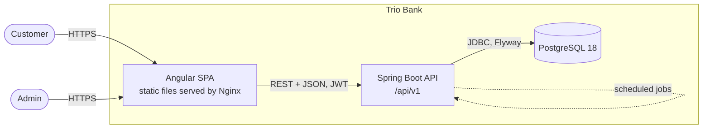
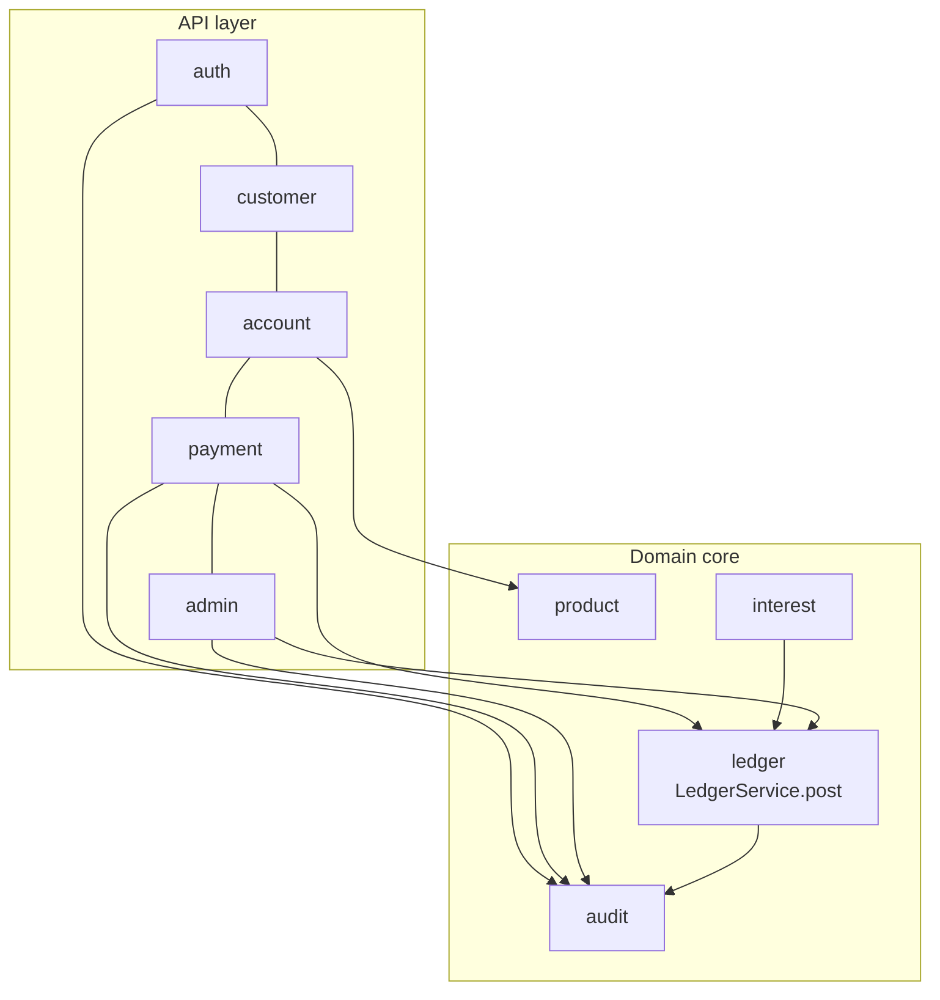
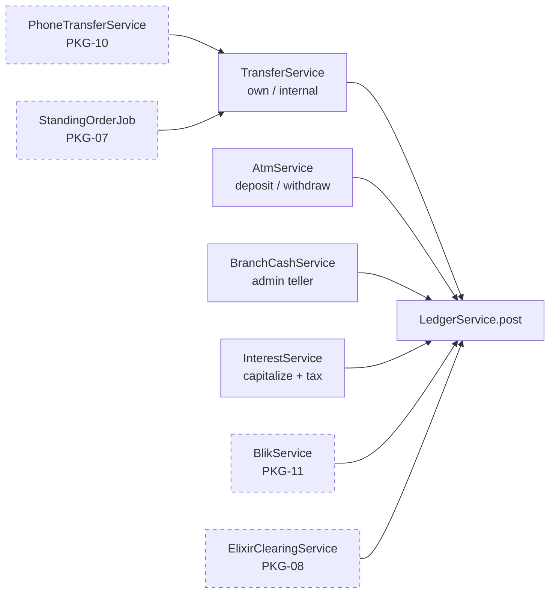
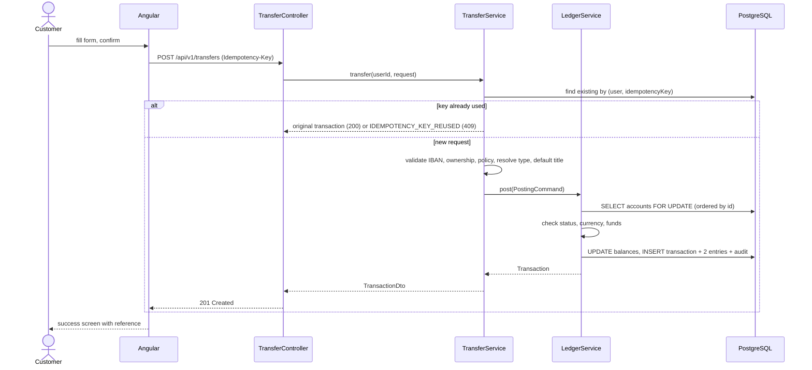
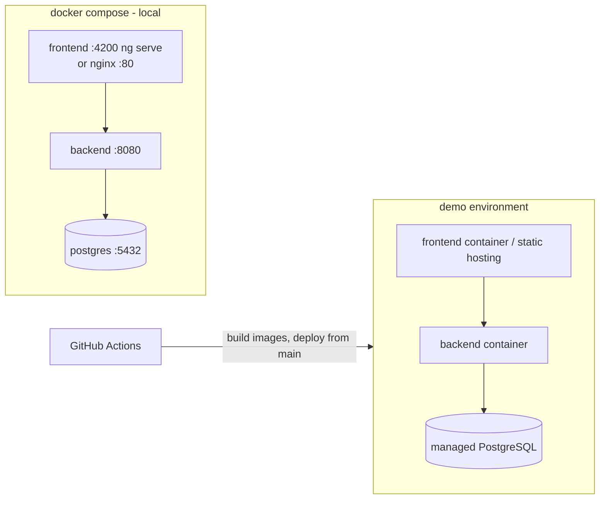

# 04 — Architecture

## 1. System context



- **Frontend:** single-page application. Talks to the backend only through the REST API defined in [05](05-api-contract.md).
- **Backend:** stateless REST API (no server sessions). All business rules live here.
- **Database:** PostgreSQL. Schema owned by Flyway migrations in the backend.
- **Scheduled jobs:** run inside the backend (Spring `@Scheduled`) — interest accrual and capitalization.

Future external systems (Elixir clearing, BLIK, mail server) are integrated as backend modules behind interfaces; the frontend never talks to them directly.

## 2. Architectural style

**Modular monolith, package-by-feature** ([ADR-0002](adr/0002-modular-monolith.md)): one deployable backend, divided into feature modules with clear boundaries. This keeps deployment simple for a 3-person team while allowing a module to be extracted later.



### 2.1 Backend modules

| Module | Responsibility | Depends on |
|---|---|---|
| `common` | Error handling, money/IBAN/PESEL utilities, clock, base entity, pagination | — |
| `audit` | Writing and querying audit events | common |
| `auth` | Registration, login, JWT, lockout, `/me`, admin bootstrap | customer, account, audit |
| `customer` | Customer profile | common |
| `product` | Account product catalog | common |
| `account` | Opening, listing, renaming accounts; IBAN generation; history queries | product, customer, ledger (read) |
| `ledger` | **Core:** posting transactions with double entry, locking, invariants | audit |
| `payment` | Transfers (own/internal), ATM operations, idempotency, type resolution | account, ledger |
| `interest` | Accrual and capitalization jobs | account, ledger |
| `admin` | Admin use cases: customers, blocking, branch cash, transactions, audit, jobs | all above |

Rule: a module uses another module only through its **service** (public API), never its repositories directly.

### 2.2 Layers inside a module

```
controller  →  service  →  repository  →  database
   ↑ DTOs        ↑ entities, domain logic
```

| Layer | Contains | Must not |
|---|---|---|
| Controller | REST endpoints, request validation (`@Valid`), mapping DTO ↔ service call | Contain business logic, touch repositories, return entities |
| Service | Use cases, business rules, `@Transactional` boundaries | Know about HTTP |
| Repository | Spring Data JPA interfaces, queries | Contain business logic |
| Entity / domain | JPA entities, enums, small domain methods (e.g. `account.block(reason)`) | Be serialized to JSON |

## 3. The ledger core

Every money movement in the system goes through **one method**:

```java
Transaction LedgerService.post(PostingCommand command)
```

```java
record PostingCommand(
    TransactionType type,
    Channel channel,
    UUID sourceAccountId,
    UUID targetAccountId,
    BigDecimal amount,
    String currency,
    String title,
    String senderName,
    String recipientName,
    UUID initiatedByUserId,     // null for SYSTEM
    String idempotencyKey,      // null for SYSTEM
    String requestHash
) {}
```

What `post()` does, in **one database transaction**:

1. Lock both accounts with `SELECT … FOR UPDATE`, **always in ascending order of account id** (prevents deadlocks when A→B and B→A run concurrently).
2. Check generic invariants: both accounts `ACTIVE`, same currency, amount > 0, source ≠ target, a customer source account has enough balance.
3. Decrease source balance, increase target balance.
4. Insert the `Transaction` (status `COMPLETED`, reference from sequence).
5. Insert two `LedgerEntry` rows (DEBIT on source, CREDIT on target) with `balanceAfter`.
6. Write audit event `TRANSACTION_POSTED`.

`post()` knows **nothing** about transfers, ATMs or interest. Operation-specific rules are checked by the caller before calling it.

### 3.1 Operations on top of the core (Strategy-like)



| Operation | Resolves source / target | Specific rules | Type |
|---|---|---|---|
| Transfer | source = chosen own account; target = account by IBAN | BR-13…17, idempotency | `OWN_TRANSFER` / `INTERNAL_TRANSFER` |
| ATM deposit | `BANK_CASH` → own personal account | BR-19, BR-20 | `CASH_DEPOSIT` |
| ATM withdrawal | own personal account → `BANK_CASH` | BR-19, BR-20 | `CASH_WITHDRAWAL` |
| Branch cash | `BANK_CASH` ↔ any customer account | BR-19 (branch limits) | `CASH_DEPOSIT` / `CASH_WITHDRAWAL` |
| Interest | `BANK_INTEREST_EXPENSE` → savings; savings → `BANK_TAX_LIABILITY` | BR-21 | `INTEREST`, `TAX` |

**Adding a new payment method** = a new service that finds the two accounts and validates its own rules, then calls `post()`. No changes to the core, database constraints or history screens.

### 3.2 Transfer sequence



### 3.3 Idempotency

- Client generates a UUID `Idempotency-Key` **when the confirmation screen opens** and reuses it for retries of the same confirmation.
- Backend looks up `(initiated_by_user_id, idempotency_key)`:
  - not found → execute;
  - found with same `requestHash` → return the stored transaction with **200**;
  - found with different hash → **409** `IDEMPOTENCY_KEY_REUSED`.
- Two simultaneous requests with the same key: the unique constraint makes one fail; the service catches the violation and returns the stored transaction.

## 4. Cross-cutting concerns

| Concern | Approach | Details |
|---|---|---|
| Authentication | Stateless JWT (Spring Security resource server style filter) | [08](08-security.md) |
| Authorization | Role checks on URL patterns + ownership checks in services | [08](08-security.md) |
| Validation | Bean Validation on DTOs (format), services for business rules | [06](06-backend-guide.md) |
| Errors | Global `@RestControllerAdvice` → RFC 9457 Problem Details | [05 §3](05-api-contract.md#3-error-format) |
| Time | Injected `java.time.Clock` (UTC); `ZoneId Europe/Warsaw` for business dates | Testable jobs |
| Transactions | `@Transactional` on service methods; ledger posting is a single transaction | [06](06-backend-guide.md) |
| Concurrency | Pessimistic lock for money, optimistic `@Version` for other updates | [ADR-0009](adr/0009-locking-and-idempotency.md) |
| Logging | SLF4J, JSON in demo env, `traceId` in MDC and in error responses | NFR-OBS-01 |
| API docs | springdoc-openapi, Swagger UI at `/swagger-ui.html` (local/demo only) | [05](05-api-contract.md) |
| Scheduling | `@Scheduled` with cron in `Europe/Warsaw`; jobs idempotent | BR-21 |
| Configuration | Spring profiles `local`, `test`, `demo`; secrets from env vars | [10](10-devops.md) |

## 5. Frontend architecture (summary)

Standalone Angular components, feature folders, services with signals for state, functional HTTP interceptors and guards. Details in [07](07-frontend-guide.md).

```
core/      auth, interceptors, guards, error mapping, session timer
shared/    UI components, pipes (money, iban), validators (IBAN, PESEL)
features/  auth, dashboard, accounts, payments, atm, history, profile, admin
```

## 6. Deployment view



Hosting provider is decided in Sprint 1 ([10 §6](10-devops.md#6-environments)).

## 7. Quality attributes → design decisions

| Attribute | Decision |
|---|---|
| Correctness of money | Double-entry ledger, DB `CHECK` constraints, single posting method, invariant tests |
| Concurrency safety | Ordered pessimistic locks, idempotency keys |
| Security | BCrypt, JWT, 404 for foreign resources, audit log, lockout |
| Extensibility | Product catalog, reserved enum values, strategy services on the ledger core, additive schema evolution, API versioning |
| Testability | Injected clock, Testcontainers, layered services |
| Simplicity | Modular monolith, one repo, docker compose |
