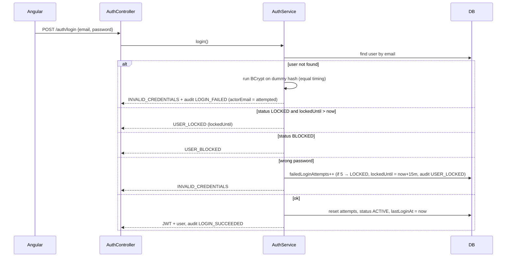

# 08 — Security

## 1. Threat model (short)

| Threat | Example | Mitigation |
|---|---|---|
| Credential guessing | Brute-force login | Lockout after 5 failures (BR-23), same error for unknown email, strong password policy (BR-02) |
| Stolen session | Token leaked from a shared computer | Short JWT lifetime (30 min), inactivity logout (10 min), `sessionStorage` |
| Accessing someone else's money | Changing `accountId` in a request | Ownership checks in every service; foreign resources → 404 (NFR-SEC-03) |
| Privilege escalation | Customer calling `/admin/*` | Role check on URL pattern + method security |
| Double spending | Double click, retries, race conditions | Idempotency keys, pessimistic locks, DB `CHECK balance >= 0` |
| Data tampering | Sending negative amount, `role: ADMIN` in register | Server-side validation; role never accepted from client; DTOs contain only allowed fields |
| Injection | SQL injection, XSS | JPA parameter binding only; Angular template escaping; no `innerHTML` with user data |
| Data leak | PESEL in logs | Masking, log rules (NFR-SEC-04), no stack traces in responses |
| Repudiation | "I didn't block that account" | Audit log with actor, IP, reason |

## 2. Authentication

### 2.1 Registration and passwords

- Passwords hashed with **BCrypt, cost 12** (`BCryptPasswordEncoder(12)`).
- Policy BR-02 checked on backend (and frontend for UX).
- Email normalized to lower case before uniqueness check and login.

### 2.2 Login flow

### 2.3 JWT

| Property | Value |
|---|---|
| Algorithm | HS256 |
| Secret | `JWT_SECRET` env var, ≥ 256 bits, different per environment, stored in GitHub Secrets |
| Lifetime | 30 minutes (`security.jwt.ttl`) |
| Claims | `sub` = userId, `role`, `cid` = customerId (absent for admins), `iat`, `exp`, `jti` |
| Transport | `Authorization: Bearer` header only (no cookies → no CSRF in MVP) |
| Validation | Signature, `exp`, and on each request a **cheap status check**: if the user is `BLOCKED`, requests are rejected with 401 (so blocking takes effect immediately). Implemented with a short cache (≤ 30 s) to avoid a DB hit per request. |

### 2.4 Known limitations

- Logout does not invalidate the token server-side; it stays valid until expiry (max 30 min). Accepted for MVP; PKG-02 adds refresh tokens with server-side revocation.
- No 2FA / transaction confirmation (PKG-09).
- No email verification (PKG-03).
- No rate limiting by IP (could be added with Bucket4j in PKG-02).

## 3. Authorization

### 3.1 Rules

1. URL level (Spring Security): `/api/v1/auth/register`, `/api/v1/auth/login`, `/actuator/health` public; `/api/v1/admin/**` requires `ADMIN`; all other `/api/v1/**` require authentication.
2. Customer endpoints additionally require role `CUSTOMER` (an admin has no customer accounts).
3. **Ownership** is enforced in services by querying with the caller's `customerId`.

### 3.2 Matrix

| Endpoint group | Guest | Customer | Admin |
|---|---|---|---|
| Register, login | ✓ | — | — |
| Logout, `/me` | — | ✓ | ✓ |
| Products, own accounts, history, transfers, ATM | — | own only | — |
| Transaction details | — | if one side is own | via admin endpoint |
| Admin customers, users, accounts, transactions, audit, branch, ledger | — | — | ✓ |
| Demo jobs | — | — | ✓ (`local`/`demo` only) |

### 3.3 Admin accounts

- No self-registration for admins. On startup, `AdminBootstrap` creates one admin from `ADMIN_EMAIL` / `ADMIN_PASSWORD` if no admin exists (FR-SYS-02), audit `ADMIN_BOOTSTRAPPED`.
- Admin cannot block themself (BR-25).

## 4. Data protection

| Data | Protection |
|---|---|
| Password | BCrypt hash only; never logged or returned |
| JWT | Never logged; only in header |
| PESEL | Masked `*******2343` in customer API and in logs; full only in admin details |
| Audit `details` | Must not contain passwords, tokens, full PESEL |
| Database | Separate DB user for the app with privileges only on its schema |
| Real data | Forbidden — fictional data only (see [01 §4.3](01-project-overview.md#43-explicitly-never-in-scope)) |

## 5. Transport and browser security

- Demo environment: HTTPS only (provided by hosting/reverse proxy); HTTP redirects to HTTPS.
- CORS: only `CORS_ALLOWED_ORIGINS` (frontend URL), methods `GET, POST, PATCH`, headers `Authorization, Content-Type, Idempotency-Key`, exposed `X-Trace-Id, Location`.
- Security headers (backend and Nginx): `X-Content-Type-Options: nosniff`, `X-Frame-Options: DENY`, `Referrer-Policy: no-referrer`, a Content-Security-Policy for the SPA, `Strict-Transport-Security` in demo.
- Swagger UI disabled outside `local`/`demo`.

## 6. Dependency and secret hygiene

- Dependabot enabled for Maven, npm, GitHub Actions and Docker.
- No secrets in the repository. `.env` files are git-ignored; `.env.example` documents the variables.
- CI uses GitHub Secrets; secret scanning / push protection enabled on the repository.

## 7. Security test checklist (see [09](09-testing.md))

- [ ] Customer A cannot read/transfer from account of customer B (404).
- [ ] Customer cannot call any `/admin/**` endpoint (403).
- [ ] Expired / tampered token → 401.
- [ ] 5 wrong passwords → locked; 6th attempt with correct password still locked.
- [ ] Blocked user's existing token stops working within 30 s.
- [ ] Registration ignores extra fields like `role`.
- [ ] Error responses contain no stack traces; logs contain no passwords/PESEL.
