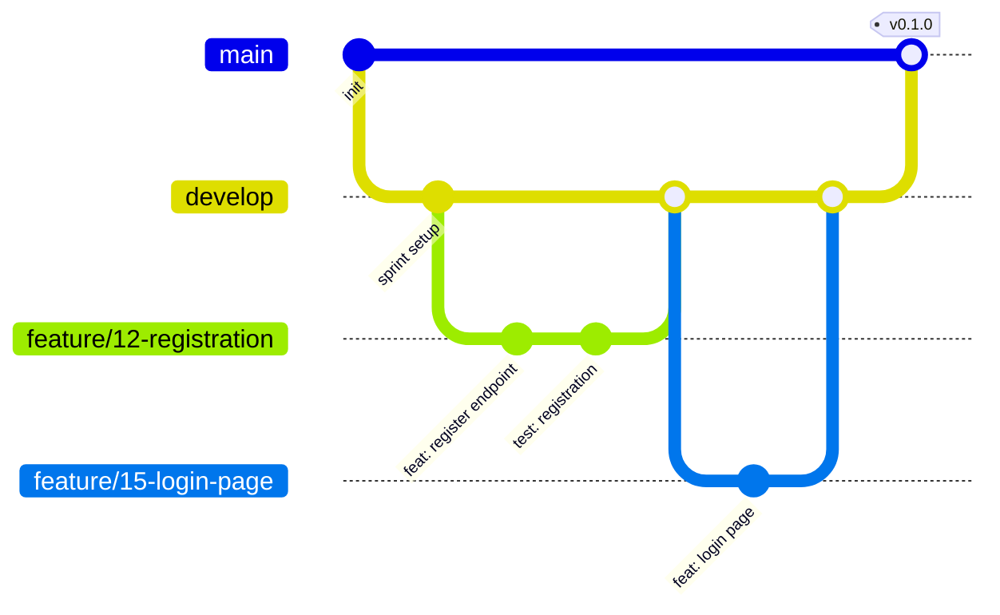

# 10 — DevOps: Repository, CI/CD, Environments

## 1. Repository layout (monorepo)

```
trio-bank/
├── .github/
│   ├── ISSUE_TEMPLATE/        # user_story.yml, task.yml, bug.yml
│   ├── workflows/             # backend-ci.yml, frontend-ci.yml, e2e.yml, docs-pdf.yml, deploy.yml
│   ├── pull_request_template.md
│   └── dependabot.yml
├── backend/                   # Spring Boot (Maven)
├── frontend/                  # Angular
├── e2e/                       # Playwright tests
├── docs/                      # this documentation
├── docker-compose.yml         # local stack
├── .env.example
├── CONTRIBUTING.md
└── README.md                  # what it is, how to run, links to docs
```

One repository keeps the API contract, code and docs in the same PR and makes the history of "who did what" visible in one place.

## 2. Branching model



| Branch | Purpose | Rules |
|---|---|---|
| `main` | Released, deployed to demo | Protected; merge only from `develop` (release PR) or `hotfix/*`; tag `vX.Y.Z` |
| `develop` | Integration branch, always buildable | Protected; PR + 1 approval + green CI; squash merge |
| `feature/<issue>-<slug>` | One issue | From `develop`, e.g. `feature/23-internal-transfer` |
| `fix/<issue>-<slug>` | Bug fix | From `develop` |
| `docs/<issue>-<slug>` | Documentation only | From `develop` |
| `hotfix/<issue>-<slug>` | Urgent fix on `main` | Merged to `main` and back to `develop` |

Protection settings for `main` and `develop`: require PR, 1 approval, dismiss stale approvals, required status checks, no force push, linear history.

## 3. Commits

[Conventional Commits](https://www.conventionalcommits.org) with issue reference:

```
feat(payment): add internal transfer endpoint (#23)
fix(auth): reset failed attempts after successful login (#41)
test(ledger): add concurrency test for withdrawals (#30)
docs(api): add history filters to contract (#27)
chore(ci): cache Maven dependencies
```

Types: `feat`, `fix`, `test`, `docs`, `refactor`, `chore`, `ci`, `build`, `perf`. Scopes = backend modules or frontend features.

## 4. Versioning and releases

- Semantic versioning; one minor release per sprint: Sprint 1 → `v0.1.0`, Sprint 2 → `v0.2.0`, … MVP → `v1.0.0`.
- Release = PR `develop → main`, tag, GitHub Release with notes generated from merged PRs, automatic deploy to demo.

## 5. CI workflows (GitHub Actions)

| Workflow | Trigger | Steps |
|---|---|---|
| `backend-ci.yml` | PR/push touching `backend/**` | Checkout → Temurin JDK 21 with Maven cache → `./mvnw -B verify` (unit + integration tests with Testcontainers, JaCoCo check, Checkstyle/Spotless) → upload test & coverage reports |
| `frontend-ci.yml` | PR/push touching `frontend/**` | Node LTS with npm cache → `npm ci` → `npm run lint` → `npm test -- --watch=false` → `npm run build` |
| `e2e.yml` | PR to `main`; nightly on `develop` | `docker compose up -d --build` → wait for health → `npx playwright test` → upload report, traces, screenshots |
| `docs-pdf.yml` | Push to `docs/**` on `develop`/`main` | Render Mermaid diagrams, combine `docs/*.md` with Pandoc into `trio-bank-docs.pdf`, upload as artifact (and attach to releases) |
| `deploy.yml` | Push of tag `v*` on `main` | Build Docker images → push to GitHub Container Registry → deploy to hosting → smoke test `/actuator/health` |

Path filters keep CI fast: a frontend-only PR does not run backend tests. Required status checks on `develop`: `backend-ci`, `frontend-ci` (both must report — use a "skipped = success" job pattern when filtered).

## 6. Environments

| Environment | Purpose | How | Data |
|---|---|---|---|
| `local` | Development | `docker compose up` (DB) + IDE / `ng serve`, or full stack in compose | Demo seed |
| `test` | Automated tests | Testcontainers in CI | Created by tests |
| `demo` | Presentation, teacher access | Deployed from `main` tags | Demo seed + manual |

Hosting for `demo` is decided in Sprint 1 by the QA/DevOps member and recorded as an ADR. Criteria: free or student tier, Docker support, managed PostgreSQL or a volume, HTTPS, does not sleep during the presentation. Candidates: a small VPS with docker compose (most control), or a PaaS such as Render, Railway, Fly.io, Azure/AWS student credits (check current free-tier limits at decision time).

## 7. Configuration and secrets

| Variable | Used by | Example (local) | Secret? |
|---|---|---|---|
| `DB_URL` | backend | `jdbc:postgresql://db:5432/triobank` | no |
| `DB_USER` / `DB_PASSWORD` | backend, db | `triobank` / `triobank` | yes in demo |
| `JWT_SECRET` | backend | 32+ random bytes, base64 | **yes** |
| `ADMIN_EMAIL` / `ADMIN_PASSWORD` | backend bootstrap | `admin@triobank.local` / … | **yes** |
| `CORS_ALLOWED_ORIGINS` | backend | `http://localhost:4200` | no |
| `SPRING_PROFILES_ACTIVE` | backend | `local` | no |
| `API_URL` | frontend build | `/api/v1` | no |

- `.env.example` in the repo lists all variables with safe placeholder values; real `.env` is git-ignored.
- Demo secrets live in GitHub Environment `demo` secrets and the hosting provider's secret store.

## 8. Local development

`docker-compose.yml` (outline):

```yaml
services:
  db:
    image: postgres:18
    environment:
      POSTGRES_DB: triobank
      POSTGRES_USER: ${DB_USER:-triobank}
      POSTGRES_PASSWORD: ${DB_PASSWORD:-triobank}
    ports: ["5432:5432"]
    volumes: [db-data:/var/lib/postgresql]   # check the data path convention of the postgres:18 image
    healthcheck:
      test: ["CMD-SHELL", "pg_isready -U triobank"]
      interval: 5s
  backend:
    build: ./backend
    env_file: .env
    environment:
      DB_URL: jdbc:postgresql://db:5432/triobank
      SPRING_PROFILES_ACTIVE: local
    ports: ["8080:8080"]
    depends_on:
      db: { condition: service_healthy }
  frontend:
    build: ./frontend          # multi-stage: node build → nginx serving dist + proxy /api → backend
    ports: ["4200:80"]
    depends_on: [backend]
volumes:
  db-data:
```

Typical workflows:

| Goal | Command |
|---|---|
| Everything in containers | `cp .env.example .env && docker compose up --build` |
| Backend in IDE | `docker compose up db` then run `TrioBankApplication` with profile `local` |
| Frontend dev server | `cd frontend && npm start` (proxy `/api` → `localhost:8080`) |
| Reset database | `docker compose down -v` |

## 9. Dockerfiles

- **Backend:** multi-stage — `maven:…-eclipse-temurin-21` build stage → `eclipse-temurin:21-jre` runtime, non-root user, `HEALTHCHECK` on `/actuator/health`.
- **Frontend:** multi-stage — `node:<lts>` build → `nginx:stable-alpine` with `nginx.conf` (SPA fallback to `index.html`, `/api` proxy, security headers, gzip).

## 10. Monitoring (demo)

- `/actuator/health` for uptime checks (UptimeRobot or the hosting's health check).
- Logs from the hosting console; each error response carries `traceId` to find the log line.

## 11. Sprint 1 checklist for QA/DevOps

- [ ] Repository, branches, protection rules, labels, issue & PR templates
- [ ] GitHub Project board with fields (see [11](11-process.md))
- [ ] Generated Spring Boot and Angular skeletons with one passing test each
- [ ] `backend-ci.yml` and `frontend-ci.yml` green
- [ ] `docker-compose.yml` + Dockerfiles; README "how to run"
- [ ] Testcontainers base class for integration tests
- [ ] Dependabot config
- [ ] Hosting decision ADR
